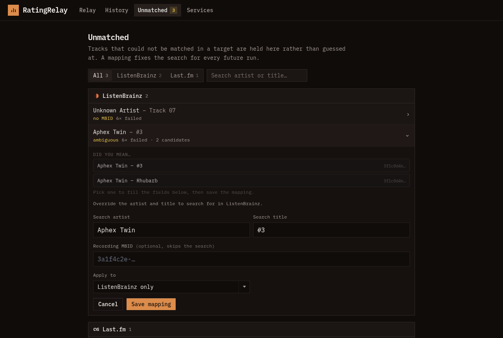

# RatingRelay

Rate a track once, and have that rating show up everywhere you listen.

RatingRelay keeps your **track ratings** in sync between **Plex**, **Last.fm** and
**ListenBrainz**. Give a song four stars in Plex and it gets loved on Last.fm and
ListenBrainz. Love something on Last.fm and it gets rated in Plex. Change your mind
later, and the relay changes it back.

It's self-hosted and built for one person and one music library. You run it on your
own machine or home server, and your credentials stay there.


## What it does

- **Rated in Plex → loved elsewhere.** Pick a cutoff, for example "at least 4 stars",
  and every track that meets it is loved on Last.fm and/or ListenBrainz.
- **Loved elsewhere → rated in Plex.** It works the other way too: your Last.fm or
  ListenBrainz loves can become star ratings in Plex.
- **Keeps up with you.** Each run compares your ratings with what it wrote last time.
  Lower a rating below the cutoff and the love is taken back.
- **Leaves your other ratings alone.** RatingRelay only undoes changes it made
  itself. Anything you loved by hand on Last.fm stays loved.
- **Doesn't guess.** Tracks are matched by their MusicBrainz ID. If a track can't be
  matched with confidence, RatingRelay sets it aside for you to check rather than
  loving the wrong song.
- **Try before you write.** A dry run does everything except change anything, so you
  can see what *would* happen first.

## Getting started

You'll need [uv](https://docs.astral.sh/uv/), [pnpm](https://pnpm.io/) and
[just](https://just.systems/) installed.

```shell
git clone https://github.com/hc-nolan/ratingrelay.git
cd ratingrelay
cp .config.example .config   # then set `secret` to something random
just install                 # download dependencies
just build                   # build the web app
uv run app.py                # start RatingRelay
```

Open `http://localhost:8100`, or `http://<your-server>:8100` from another device on
your network. If you use a different port or address, change `port` and `base_url`
in `.config` so they match.

### First-time setup

The first time you open the app, it walks you through three steps:

1. **Connect Plex.** A Plex sign-in window opens. The account you sign in with
   becomes the owner, and from then on it's also how you log in to RatingRelay.
   You don't need another password.
2. **Pick your Plex server.** Choose the server whose music library holds your
   ratings.
3. **Connect your music services.** Add Last.fm, ListenBrainz or both:
   - *Last.fm:* an [API key and secret](https://www.last.fm/api/account/create),
     plus your username and password.
   - *ListenBrainz:* your username and the user token from your
     [settings page](https://listenbrainz.org/settings/).

Press **Start relaying** when you're done.

## Using the app

### Relay

The main page reads from top to bottom:

- **From**: where your ratings come from. For Plex, choose the cutoff ("at least 4
  stars"). For ListenBrainz, choose loves or hates.
- **To**: switch on one or more destinations. ListenBrainz can receive a love or a
  hate. Plex receives a star rating.
- **Trigger**: run it **once**, or repeat it every hour, every few hours, daily or
  weekly. Tick **Dry run** to preview the run without changing anything.

Press **Queue run**. Progress appears in the **Activity** panel on the right as
tracks are processed.

**Reset** in the *From* row undoes what RatingRelay has written to a service. Only
its own changes are removed, never ratings you made yourself.

### History


Every run is listed here, newest first. Filter to runs that are still going, or to
the ones that **need a look** because something failed. Open a run to see what
happened to each track: written, already up to date, unmatched or failed.


### Unmatched



Sometimes a track can't be found on the other service. The title might be written
differently, or there might be several possible matches. Those tracks wait here
instead of being guessed at. Open one to:

- pick the right song from the suggested candidates, or
- type the artist and title as the other service spells them.

That saves a **mapping**, and every future run uses it.

An unmatched track isn't an error. Plenty of tracks in a personal library simply
don't exist on Last.fm or ListenBrainz.

### Services


See what's connected, switch Plex servers, replace an expired token or disconnect a
service. Disconnecting removes only the login details. RatingRelay still remembers
what it wrote, so if you reconnect later it picks up where it left off.

Disconnecting **Plex** also signs you out, because your Plex account is how you log
in to RatingRelay. You'll be asked to confirm first.

## Running without the web app

Everything the web app does can also run from the command line, for example from
cron on a server you don't want to open a browser on. Both use the same relay code,
so a command-line run and a run in the app always agree. The web server doesn't
need to be running.

```shell
# One relay, from flags. This is the shape to try first.
uv run ratingrelay relay --source plex --target lastfm --dry-run

# Relay to several targets at once.
uv run ratingrelay relay --source plex --target lastfm --target listenbrainz

# Everything a config file defines, one after another.
uv run ratingrelay run --config relays.toml
uv run ratingrelay list --config relays.toml   # what would run
```

`--dry-run` runs the real pipeline (fetch, match, reconcile) and skips only the
writes, so its counts are what a real run would do.

| flag | command | what it does |
| ---- | ------- | ------------ |
| `--source SERVICE` | `relay` | where ratings come from: `plex`, `lastfm`, `listenbrainz` (default `plex`) |
| `--target SERVICE` | `relay` | where they go; repeat for more than one (default `lastfm`) |
| `--rating-threshold N` | `relay` | Plex source: the rating a track needs, out of 10 (default `8`) |
| `--comparison gte\|lte` | `relay` | Plex source: at least or at most the threshold |
| `--feedback-type love\|hate` | `relay` | Last.fm/ListenBrainz: which feedback to relay |
| `--plex-rating N` | `relay` | Plex target: the rating to write, out of 10 (default `10`) |
| `--config PATH` | `run`, `list` | relay definitions to read (default `relays.toml`) |
| `--only NAME` | `run` | run just the named relay; repeatable |
| `--dry-run` | `relay`, `run` | fetch, match and reconcile for real; write nothing |
| `--json` | `relay`, `run` | one machine-readable document instead of the human summary |
| `--verbose` | `relay`, `run` | a line per track, on stderr |

Credentials come from `.config` (or environment variables), falling back to the
ones you entered in the web app. On a fresh checkout, run `just migrate` first.

### Config file

`relays.toml.example` is a starting point. Each `[[relay]]` block is one relay:

```toml
[[relay]]
name = "nightly"
source = "plex"
targets = ["lastfm", "listenbrainz"]
rating_threshold = 8.0

[[relay]]
name = "back-to-plex"
source = "lastfm"
targets = ["plex"]
plex_rating = 10.0
```

Unknown keys are an error, so a typo can't make a cron job silently do nothing.

### cron

```cron
0 4 * * * cd /srv/ratingrelay && /usr/local/bin/uv run ratingrelay run >> /var/log/ratingrelay.log 2>&1
```

A clean run prints a short summary; failures are loud. Exit codes:

| code | meaning |
| ---- | ------- |
| 0 | ran; nothing failed |
| 1 | ran; some tracks failed on a target |
| 2 | could not complete (bad config, missing database, fetch error) |

Unmatched tracks don't count as failures. They're counted in the output and listed
on the web app's **Unmatched** page. A dry run can only exit 0 or 2.

## Development

```shell
just install     # uv sync + pnpm install
just dev         # API on :8100 + Vite dev server on :5173, Ctrl-C stops both
just demo        # the UI against made-up data on :5174; calls no real service
just test        # pytest
just lint        # pylint
just check       # svelte-check + prettier + eslint
```

The screenshots above come from `just demo`. Contributor notes, including the
layering rules and the behaviour the relay must not regress, are in `AGENTS.md`.
