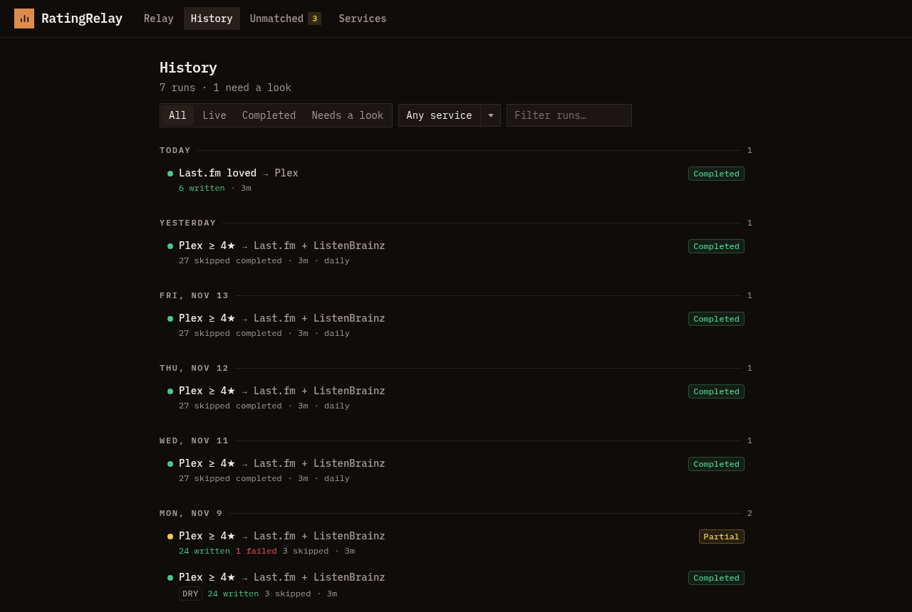
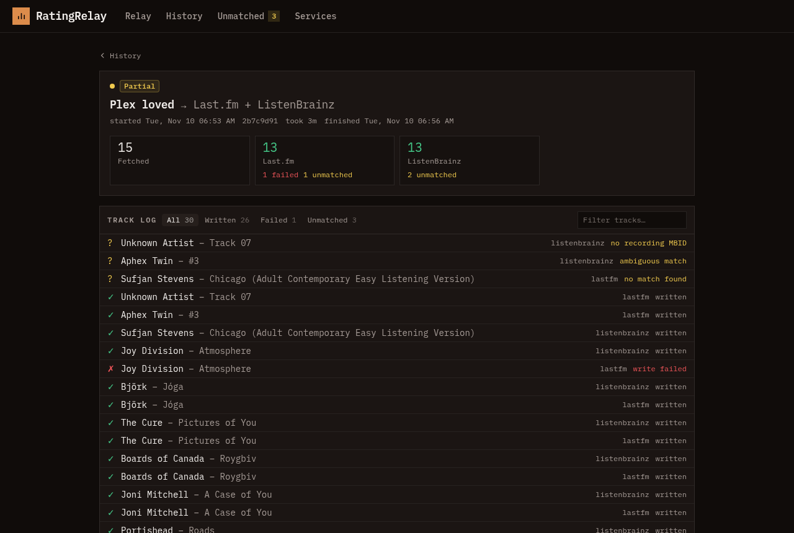
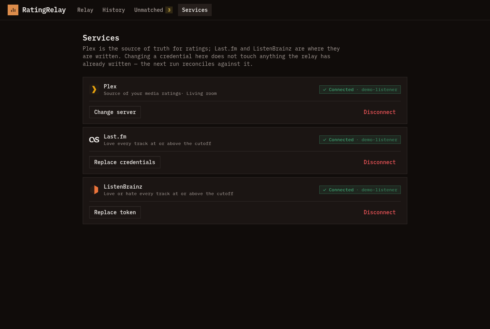

# RatingRelay

Rate a track once, and have that rating show up everywhere you listen.

RatingRelay keeps your **track ratings** in sync between **Plex**, **Last.fm** and
**ListenBrainz**. Give a song four stars in Plex and it gets loved on Last.fm and
ListenBrainz. Love something on Last.fm and it gets rated in Plex. Change your mind
later, and the relay changes it back.

It's self-hosted and built for one person and one music library. You run it on your
own machine or home server, and your credentials stay there.


## What it does

- **Rated in Plex → loved elsewhere.** Every track rated at or above your love cutoff
  (4 stars unless you change it) is loved on Last.fm and/or ListenBrainz.
- **Loved elsewhere → rated in Plex.** It works the other way too: your Last.fm or
  ListenBrainz loves become that same rating in Plex. See
  [Rating thresholds](#rating-thresholds).
- **Keeps up with you.** Each run compares your ratings with what it wrote last time.
  Lower a rating below the cutoff and the love is taken back.
- **Leaves your other ratings alone.** RatingRelay only undoes changes it made
  itself. Anything you loved by hand on Last.fm stays loved.
- **Doesn't guess.** Tracks are matched by their MusicBrainz ID. If a track can't be
  matched with confidence, RatingRelay sets it aside for you to check rather than
  loving the wrong song.
- **Try before you write.** A dry run does everything except change anything, so you
  can see what *would* happen first.

## Getting started

RatingRelay runs in Docker. You need [Docker](https://docs.docker.com/get-docker/)
with the Compose plugin.

```shell
git clone https://github.com/hc-nolan/ratingrelay.git
cd ratingrelay
cp .env.example .env
```

Open `.env` and set `RATINGRELAY_SECRET` to a long random string. Running
`openssl rand -hex 32` will make one. You can also set your time zone there. Then:

```shell
docker compose up -d --build
```

Open `http://<your-server>:8100`, or `http://localhost:8100` if Docker runs on the
same computer. To use a different port, change `RATINGRELAY_PORT` in `.env`.

If you reach RatingRelay through a reverse proxy or your own domain, uncomment
`BASE_URL` in `compose.yaml` and set it to the address you type in the browser.
The Plex sign-in sends you back to that address.

### First-time setup

The first time you open the app, it walks you through three steps:

1. **Connect Plex.** A Plex sign-in window opens. The account you sign in with
   becomes the owner, and from then on it's also how you log in to RatingRelay.
   You don't need another password.
2. **Pick your Plex server.** Choose the server whose music library holds your
   ratings.
3. **Connect your music services.** Add Last.fm, ListenBrainz or both:
   - *Last.fm:* an [API key and secret](https://www.last.fm/api/account/create),
     plus your username and password.
   - *ListenBrainz:* your username and the user token from your
     [settings page](https://listenbrainz.org/settings/).

Press **Start relaying** when you're done.

## Using the app

### Relay

The main page reads from top to bottom:

- **From**: where your ratings come from. For Plex and ListenBrainz, choose loves or
  hates.
- **To**: switch on one or more destinations. Each one writes what *From* reads:
  loves become loves, hates become hates. Plex receives the love (or hate) rating.
  Last.fm only has loves, so it isn't offered for a hate relay.
- **Trigger**: run it **once**, or repeat it every hour, every few hours, daily or
  weekly. Tick **Dry run** to preview the run without changing anything.

Press **Queue run**. Progress appears in the **Activity** panel on the right as
tracks are processed.

**Reset** in the *From* row undoes what RatingRelay has written to a service. Only
its own changes are removed, never ratings you made yourself.

### Rating thresholds

Two thresholds decide which Plex ratings count as a love and a hate. They apply to
every relay, scheduled ones included, so a two-way setup writes back exactly what
it reads:

| threshold | default | Plex as a source | Plex as a target |
| --------- | ------- | ---------------- | ---------------- |
| love | 4 stars | loves are tracks rated at least this | a love is written as this rating |
| hate | 1 star | hates are tracks rated at most this | a hate is written as this rating |

Change them in the web app's **Rating** box; the hate threshold must be below the
love one. To pin one instead, set it in `.env` (`RATINGRELAY_LOVE_THRESHOLD`,
`RATINGRELAY_HATE_THRESHOLD`, out of 10, so each star is 2) and run
`docker compose up -d` again; the web app then shows it read-only. The headless
CLI uses the same values.

A track already rated on the right side of the threshold is left alone: a love
relay doesn't touch a track you rated 4 or 5 stars, and a hate relay doesn't touch
one you rated 1 star. Raising the love threshold means some tracks no longer count,
so the next run takes those loves back.

### History



Every run is listed here, newest first. Filter to runs that are still going, or to
the ones that **need a look** because something failed. Open a run to see what
happened to each track: written, already up to date, unmatched or failed.



### Unmatched


Sometimes a track can't be found on the other service. The title might be written
differently, or there might be several possible matches. Those tracks wait here
instead of being guessed at. Open one to:

- pick the right song from the suggested candidates, or
- type the artist and title as the other service spells them.

That saves a **mapping**, and every future run uses it.

An unmatched track isn't an error. Plenty of tracks in a personal library simply
don't exist on Last.fm or ListenBrainz.

### Services



See what's connected, switch Plex servers, replace an expired token or disconnect a
service. Disconnecting removes only the login details. RatingRelay still remembers
what it wrote, so if you reconnect later it picks up where it left off.

Disconnecting **Plex** also signs you out, because your Plex account is how you log
in to RatingRelay. You'll be asked to confirm first.

## Keeping it private

RatingRelay is built for one person on a home network. Keep it off the open
internet. If you need it away from home, use a VPN, not a port forward. Your Plex
account is the only login it has, so:

- **Finish setup as soon as it starts.** Until a Plex account is connected, anyone
  who can reach the app can use it. The first account to connect becomes the owner.
- **Disconnecting Plex opens it up again** until you reconnect. Do it from a network
  you trust.
- **Only approve Plex sign-ins you started.** RatingRelay can't tell who opened a
  Plex sign-in prompt. If you approve a link someone else sent you, they get signed
  in to your RatingRelay.

## Your data

Everything RatingRelay knows is kept in the `ratingrelay-data` Docker volume. That
includes your connected accounts, run history, mappings and a record of every
change it has made. That record is how it can undo its own changes without touching
yours. Back up the volume if you care about it, and don't delete it when updating.

## Updating

```shell
git pull
docker compose up -d --build
```

The database is upgraded automatically when the new version starts.

## Running without the web app

Everything the web app does can also run from the command line. Both use the same
relay code, so a command-line run and a run in the app always agree.

You probably don't need this if you use Docker: the app's **Repeat** option
already runs a relay on a schedule. The command line is for scripting, for cron,
or for running RatingRelay with no web app at all.

With Docker, run the commands inside the container:

```shell
docker compose exec ratingrelay ratingrelay relay --source plex --target lastfm --dry-run
```

To use a config file, uncomment the `relays.toml` line under `volumes:` in
`compose.yaml` and pass `--config /data/relays.toml`. The examples below show the
commands on their own; outside Docker, run them with `uv run` in front.

```shell
# One relay, from flags. This is the shape to try first.
ratingrelay relay --source plex --target lastfm --dry-run

# Relay to several targets at once.
ratingrelay relay --source plex --target lastfm --target listenbrainz

# Everything a config file defines, one after another.
ratingrelay run --config relays.toml
ratingrelay list --config relays.toml   # what would run
```

`--dry-run` runs the real pipeline (fetch, match, reconcile) and skips only the
writes, so its counts are what a real run would do.

| flag | command | what it does |
| ---- | ------- | ------------ |
| `--source SERVICE` | `relay` | where ratings come from: `plex`, `lastfm`, `listenbrainz` (default `plex`) |
| `--target SERVICE` | `relay` | where they go; repeat for more than one (default `lastfm`) |
| `--feedback-type love\|hate` | `relay` | relay loves or hates (default `love`); for Plex, see [Rating thresholds](#rating-thresholds) |
| `--config PATH` | `run`, `list` | relay definitions to read (default `relays.toml`) |
| `--only NAME` | `run` | run just the named relay; repeatable |
| `--dry-run` | `relay`, `run` | fetch, match and reconcile for real; write nothing |
| `--allow-mass-undo` | `relay`, `run` | this run only: undo even when most of a target's changes were withdrawn (see below) |
| `--json` | `relay`, `run` | one machine-readable document instead of the human summary |
| `--verbose` | `relay`, `run` | a line per track, on stderr |

Credentials come from environment variables (or `.config` outside Docker), falling
back to the ones you entered in the web app. Outside Docker, run `just migrate`
first on a fresh checkout. The container does this when it starts.

### Config file

`relays.toml.example` is a starting point. Each `[[relay]]` block is one relay:

```toml
[[relay]]
name = "nightly"
source = "plex"
targets = ["lastfm", "listenbrainz"]
feedback_type = "love"

[[relay]]
name = "back-to-plex"
source = "lastfm"
targets = ["plex"]
```

Unknown keys are an error, so a typo can't make a cron job silently do nothing.

Two relays may share a source and a target if they read opposite directions (Plex
loves and Plex hates, both to ListenBrainz). Two that read the same direction, such
as two Plex love relays into one target, are refused: each run would undo what only
the other one passes. Merge them into one relay.

### When a run refuses to undo

If a run would take back more than half of what RatingRelay has written to a
target, and at least 10 changes, it takes back none of them. The tracks are counted
as failed, the run exits 1, and the summary names the target. That almost always
means the source answered with an empty or short list, not that you un-loved most
of your library overnight.

If you really did, run once with `--allow-mass-undo`, or use **Run once and allow
the undo** on that run's page in the web app. There is no config key for it, so a
scheduled run never switches the guard off.

### cron

```cron
# Docker
0 4 * * * cd /srv/ratingrelay && docker compose exec -T ratingrelay ratingrelay run --config /data/relays.toml >> /var/log/ratingrelay.log 2>&1
# From source
0 4 * * * cd /srv/ratingrelay && /usr/local/bin/uv run ratingrelay run >> /var/log/ratingrelay.log 2>&1
```

A clean run prints a short summary; failures are loud. Exit codes:

| code | meaning |
| ---- | ------- |
| 0 | ran; nothing failed |
| 1 | ran; some tracks failed on a target |
| 2 | could not complete (bad config, missing database, fetch error) |

Unmatched tracks don't count as failures. They're counted in the output and listed
on the web app's **Unmatched** page. A dry run exits 1 only where the real run would
refuse a mass undo, and 0 or 2 otherwise.

## Development

To run from source instead of Docker, you'll need [uv](https://docs.astral.sh/uv/),
[pnpm](https://pnpm.io/) and [just](https://just.systems/).

```shell
cp .config.example .config   # settings and, optionally, credentials
just install     # uv sync + pnpm install
just dev         # API on :8100 + Vite dev server on :5173, Ctrl-C stops both
just demo        # the UI against made-up data on :5174; calls no real service
just screenshots # re-take docs/screenshots from that demo data
just test        # pytest
just lint        # pylint
just check       # svelte-check + prettier + eslint
just build && uv run app.py   # serve the built app from the API, as the image does
```

The screenshots above come from `just demo`; `just screenshots` re-takes them from
that same seeded data, so they can't drift from the UI. Contributor notes,
including the layering rules and the behaviour the relay must not regress, are in
`AGENTS.md`.
